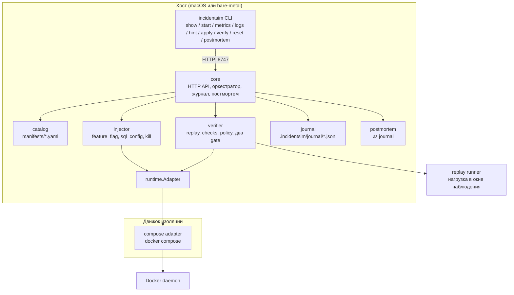
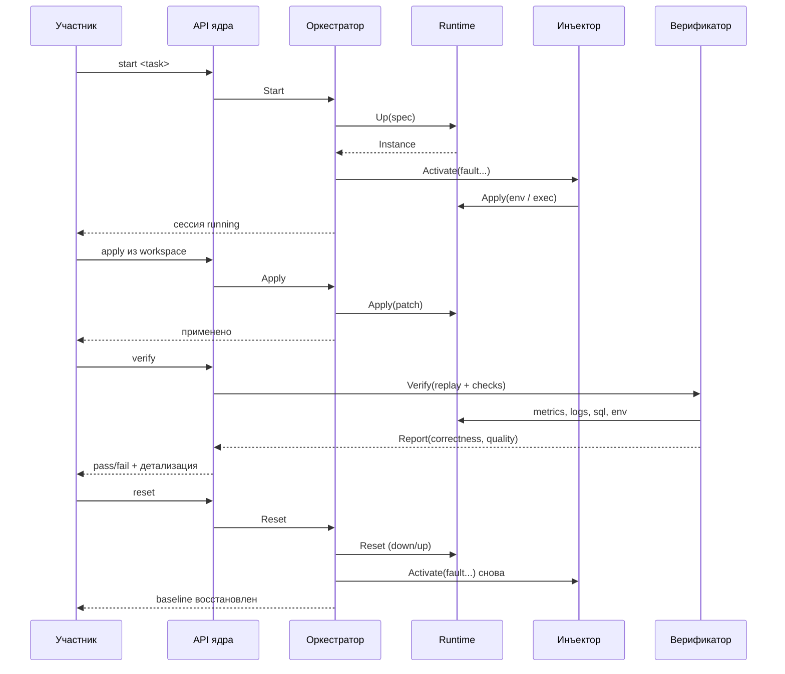
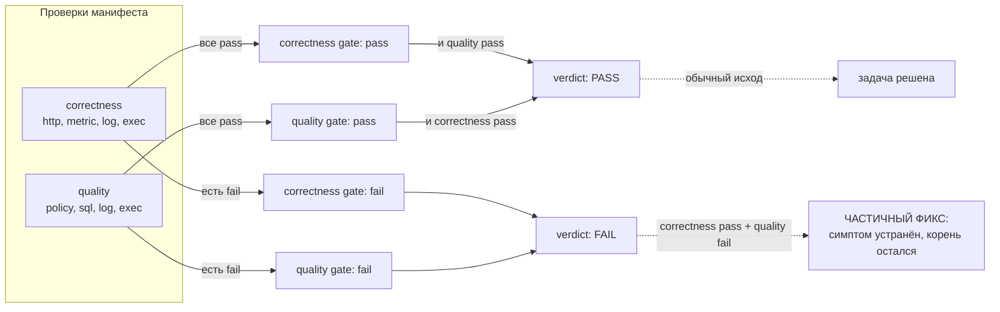

# Архитектура

Спецификация — [`../README.md`](../README.md). Здесь — диаграммы и связи,
которые в тексте спецификации разъехались бы.

## Компоненты

## Жизненный цикл сессии

## Два шлюза

Ключевая точка на схеме: красный `quality` при зелёном `correctness` — это не
ошибка проверки, а главный результат симулятора.
